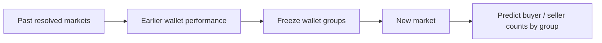

# HackTheBruh

**How many wallets with strong or weak prior performance will buy or sell a new market?** Starting with [Polymarket Finance](https://polymarket.com/finance).

**Current target: earlier wallet performance → wallet groups → later buyer/seller counts.**

[Participation target and proposed profit-based groups →](docs/research/wallet-participation-target.md)

**[First participation results: 100 earlier markets → 20 later markets →](analysis/participation/2026-01/v1/README.md)**




**[Explore the 100-market dataset →](datasets/finance/resolved-100-2025/v1/README.md)** · [Single-market Anthropic example](datasets/finance/anthropic-ipo-1_25t-1_5t/v1/README.md)


The first participation model trains on **100 markets from 2025** and predicts next-seven-day buyer/seller counts on **20 later markets from January 2026**. Average error is **1.57 wallets versus 1.80** for historical rates. Groups use a provisional reported-return measure; one candidate qualifies for the stronger proxy, 26 for the other proxy and 73 remain unknown. This is a 100-wallet pilot with limited coverage, not validated wallet skill.

[Earlier edge-based wallet metrics →](analysis/finance-wallets/2025-12-01/v1/README.md) · [Separate YES/NO-outcome experiment →](analysis/finance-backtest/2025-12/v1/README.md)

[Top 100 active wallet IDs and training targets →](analysis/active-finance-wallets/README.md)

## Try it

Python 3.11+ · No API key · No third-party runtime dependencies

**1 · Activate the environment**

```powershell
# .venv already exists locally. Create it after a fresh clone.
python -m venv .venv
.\.venv\Scripts\Activate.ps1
```

If PowerShell blocks activation, use `.\.venv\Scripts\python.exe` in place of `python` below.

**2 · Verify the downloaded dataset**

```powershell
python -m polyresearch.resolved_dataset --verify-only
```

**3 · Reproduce the participation pilot**

```powershell
python -m polyresearch.position_evidence
python -m polyresearch.participation
```

Cached position responses are reused. [Predictions, actual counts, group definitions and limitations →](analysis/participation/2026-01/v1/README.md)

**4 · Collect a fresh snapshot**

```powershell
python -m polyresearch.resolved_dataset --out data/resolved-100-fresh
```

The 100-market selection rules are configured. Use a new output directory for each snapshot.

**5 · Check the tests**

```powershell
python -m unittest discover -s tests -v
```

Top/bottom deciles are relative historical rankings. Wallets without enough earlier evidence remain unknown.

[Research: how should we define wallet skill? →](docs/research/wallet-skill.md)

[Experiment: rank wallets first, predict later →](docs/research/resolved-market-backtest.md)

[Methodology, assumptions & API references →](docs/methodology.md)
