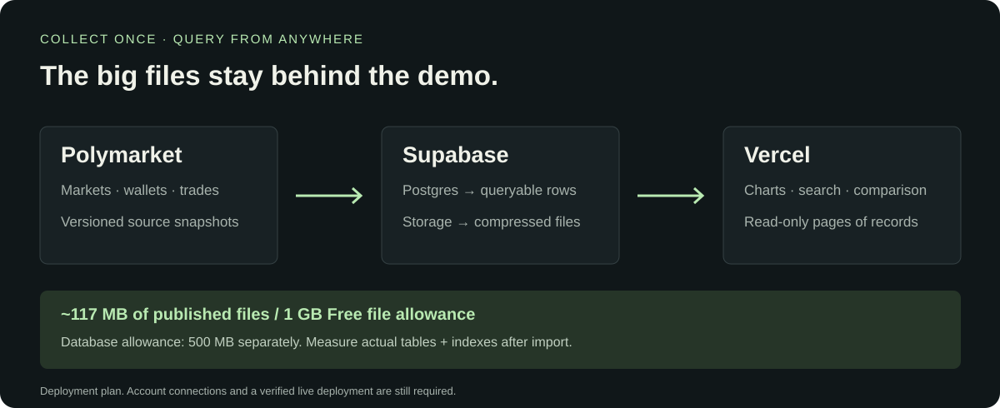

# ↗ HackTheBruh

**Who will buy or sell next week?** Earlier wallet performance → later market participation.

[](web/README.md)

**[Demo guide →](web/README.md)** · **[Browse data →](docs/data-catalog.md)** · **[Actual results →](analysis/participation/2026-01/v1/README.md)**

| 100 earlier markets | 20 later markets | Next 7 days | 100 candidate wallets |
| :---: | :---: | :---: | :---: |
| 2025 Finance | January 2026 Finance | Unique buyers / sellers | Earlier-only selection |


**Provisional groups:** 1 stronger, 26 other, 73 unknown. Stronger-group predictions did not beat the baseline. The candidate set covers about 5% of observed participant-market pairs.



**Deployment:** Supabase schema created; dataset upload and Vercel deployment pending. The local demo is labeled snapshot preview until connected.

<details><summary>Run locally</summary>

```powershell
node scripts/build-demo.mjs
node scripts/preview-demo.mjs
```

Open [localhost:4173](http://127.0.0.1:4173). Node 20+; no npm install.

</details>

<details><summary>Reproduce the research</summary>

The first participation model trains on **100 markets from 2025** and predicts next-seven-day buyer/seller counts on **20 later markets from January 2026**. Average error is **1.57 wallets versus 1.80** for historical rates. Groups use a provisional reported-return measure; one candidate qualifies for the stronger proxy, 26 for the other proxy and 73 remain unknown. This is a 100-wallet pilot with limited coverage, not validated wallet skill.

```powershell
python -m venv .venv
.\.venv\Scripts\python.exe -m polyresearch.resolved_dataset --verify-only
.\.venv\Scripts\python.exe -m polyresearch.position_evidence
.\.venv\Scripts\python.exe -m polyresearch.participation
.\.venv\Scripts\python.exe -m unittest discover -s tests -v
```

[Earlier wallet metrics](analysis/finance-wallets/2025-12-01/v1/README.md) · [YES/NO outcome experiment](analysis/finance-backtest/2025-12/v1/README.md) · [Top wallet IDs](analysis/active-finance-wallets/README.md)

</details>

**[Visual documentation hub →](docs/README.md)** · [Cloud setup](docs/deployment.md) · [Research target](docs/research/wallet-participation-target.md)

## FastAPI backend

Install the API dependencies and start the server from the repository root:

```sh
python -m pip install -e .
python -m uvicorn backend.main:app --reload
```

Set `SUPABASE_URL` and `SUPABASE_KEY` in the root `.env` file. `SUPABASE_URL` should be the project URL (for example, `https://<project-ref>.supabase.co`); a trailing `/rest/v1` is also accepted.

The API provides `GET /markets`, `GET /markets/{market_id}/wallets`, `GET /wallets/{wallet_id}/stats`, and `POST /wallets/{wallet_id}/classify`. Use [interactive API docs](http://127.0.0.1:8000/docs) to inspect request parameters and try the endpoints.
