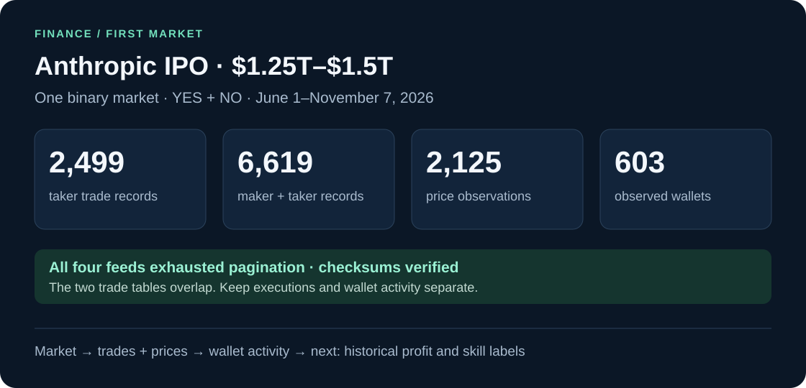
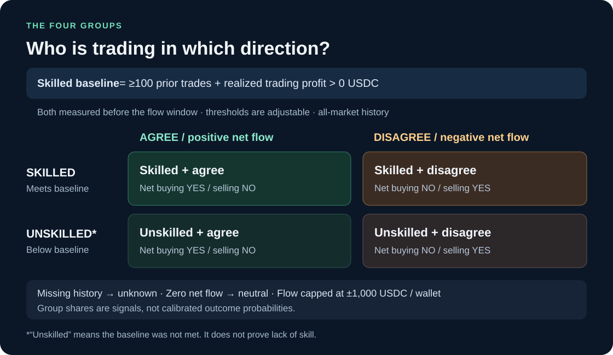

# HackTheBruh

**Do successful wallets move before the crowd?** Starting with [Polymarket Finance](https://polymarket.com/finance).

**First market: Anthropic IPO closing market cap · $1.25T–$1.5T**

**[Explore the dataset →](datasets/finance/anthropic-ipo-1_25t-1_5t/v1/README.md)** · [View the market](https://polymarket.com/event/anthropic-ipo-closing-market-cap-higher-strikes/will-anthropics-market-cap-be-between-1pt25t-and-1pt5t-at-market-close-on-ipo-day)



Data first → historical wallet profit → skill groups → test the forecast.

This market opened in June 2026. Its first dataset covers **June 1–November 7, 2026**, rather than the original 2025 research window.

## Try it

Python 3.11+ · No API key · No third-party runtime dependencies

**1 · Activate the environment**

```powershell
# .venv already exists locally. Create it after a fresh clone.
python -m venv .venv
.\.venv\Scripts\Activate.ps1
```

If PowerShell blocks activation, use `.\.venv\Scripts\python.exe` in place of `python` below.

**2 · Verify the downloaded dataset**

```powershell
python -m polyresearch.market_dataset --verify-only
```

**3 · Collect a fresh snapshot**

```powershell
python -m polyresearch.market_dataset --out data/anthropic-fresh
```

The exact market URL is already configured. Use a new output directory for each snapshot.

**4 · Check the tests**

```powershell
python -m unittest discover -s tests -v
```



Wallet history enrichment and skill labels come next. This release contains observed data and wallet activity summaries.

[Methodology, assumptions & API references →](docs/methodology.md)
