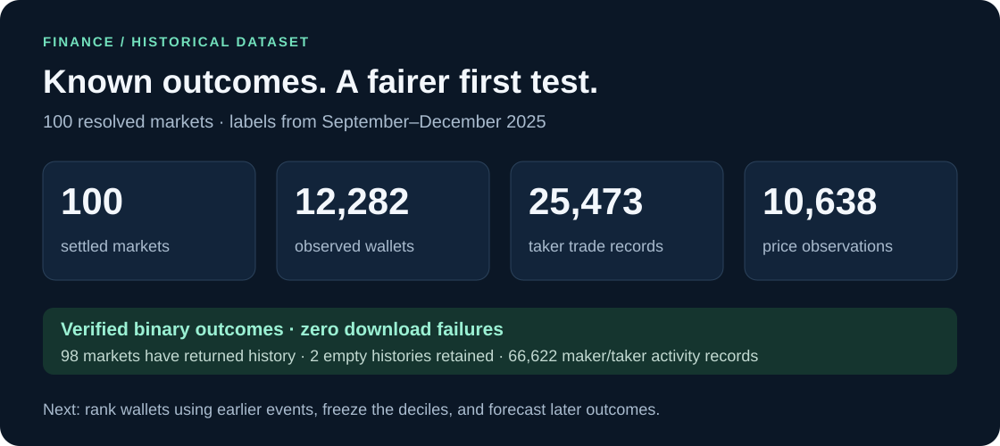
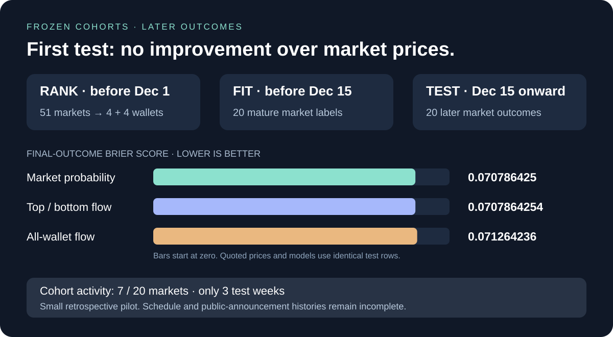

# HackTheBruh

**Do successful wallets move before the crowd?** Starting with [Polymarket Finance](https://polymarket.com/finance).

**First backtest: 100 resolved finance markets → top/bottom wallet deciles → later outcomes.**

**[Explore the 100-market dataset →](datasets/finance/resolved-100-2025/v1/README.md)** · [Single-market Anthropic example](datasets/finance/anthropic-ipo-1_25t-1_5t/v1/README.md)






The resolved sample has final labels from **September–December 2025**. The first implemented pilot ranks **43 wallets** on earlier evidence and tests frozen cohorts on **20 later markets**. It shows **no improvement over market prices**.

[Wallet metrics and definitions →](analysis/finance-wallets/2025-12-01/v1/README.md) · [Forecast results and limitations →](analysis/finance-backtest/2025-12/v1/README.md)

[Top 100 active wallet IDs and training targets →](analysis/active-finance-wallets/README.md)

## Try it

Python 3.11+ · No API key · No third-party runtime dependencies

**1 · Activate the environment**

```powershell
# .venv already exists locally. Create it after a fresh clone.
python -m venv .venv
.\.venv\Scripts\Activate.ps1
```

If PowerShell blocks activation, use `.\.venv\Scripts\python.exe` in place of `python` below.

**2 · Verify the downloaded dataset**

```powershell
python -m polyresearch.resolved_dataset --verify-only
```

**3 · Reproduce wallet rankings and the forecast pilot**

```powershell
python -m polyresearch.wallet_metrics --enrich-pnl
python -m polyresearch.backtest
```

Cached PnL responses are reused. After-cost ROI and individual wallet Brier skill stay missing until suitable evidence is supplied.

**4 · Collect a fresh snapshot**

```powershell
python -m polyresearch.resolved_dataset --out data/resolved-100-fresh
```

The 100-market selection rules are configured. Use a new output directory for each snapshot.

**5 · Check the tests**

```powershell
python -m unittest discover -s tests -v
```

Top/bottom deciles are relative historical rankings. Wallets without enough earlier evidence remain unknown.

[Research: how should we define wallet skill? →](docs/research/wallet-skill.md)

[Experiment: rank wallets first, predict later →](docs/research/resolved-market-backtest.md)

[Methodology, assumptions & API references →](docs/methodology.md)
