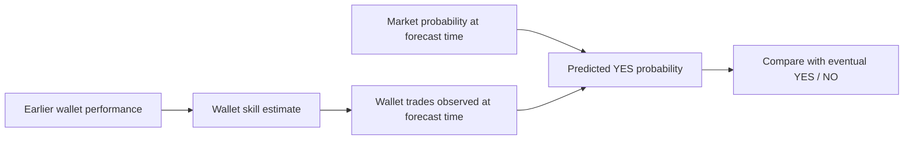

# Find 100 recurring Finance wallets


**These are the most active wallets in our selected 100-market Finance sample, not platform-wide leaders.** Default activity means distinct resolved economic groups, with trade-leg count as the secondary sort and wallet address as the deterministic final tie rule. Both maker and taker activity count. Repeated fills are not additional independent markets. Activity is a sampling rule, not a skill label.

| Cutoff, UTC | Earlier resolved source markets | Top 100: minimum market count | At least five markets | At least five taker markets | Downloads |
| --- | ---: | ---: | ---: | ---: | --- |
| December 1, 2025 | 51 | 4 | 93 | 43 | [CSV](before-2025-12-01/v1/top_wallets.csv) · [IDs only](before-2025-12-01/v1/wallet_ids.txt) |
| January 1, 2026 | 100 | 7 | 100 | 55 | [CSV](before-2026-01-01/v1/top_wallets.csv) · [IDs only](before-2026-01-01/v1/wallet_ids.txt) |

For the December backtest, use the December 1 list. The year-end list is descriptive or usable for a new later evaluation; it cannot retrospectively select wallets for forecasts earlier in December. A market must have a final label strictly before cutoff; included trade rows must precede both cutoff and formal resolution. Trades span each selected market's available history, not exclusively the month in the output folder.

The CSV contains market counts, taker-only market counts, all-side trade-leg counts, taker counts, observed notional and first/last trade timestamps. It includes both market-count and trade-count ranks across the eligible source population, although the exported 100 are selected by the configured ordering. Taker rows overlap the all-side feed; never add their counts to all-side counts. These are API records, not necessarily distinct economic bets. Summing notional across wallets double-counts counterparties and is not market volume.

The five widest-participating year-end addresses have no taker rows in this sample. Broad activity can reflect small automated maker orders rather than directional forecasting. Keep taker evidence separate when estimating information skill; selecting 100 all-side wallets does not create 100 wallets with five earlier taker markets. In particular, the earlier list still contains only the same 43 wallets meeting that taker floor.

```powershell
python -m polyresearch.active_wallets
python -m polyresearch.active_wallets --as-of 2026-01-01 --out analysis/active-finance-wallets/before-2026-01-01/v1
# For the 100 wallets with the most activity records instead of market breadth:
python -m polyresearch.active_wallets --order trade-legs --out data/top100-by-trade-count
```

Ranking existing downloaded data is inexpensive. Finding the true top 100 across all Finance requires a wider resolved-market catalog, a fixed observation window and complete pagination. Neither market participant lists nor a current profit leaderboard supplies that historical activity ranking on its own.

## What are we training to predict?

**Updated target:** predict how many wallets in each earlier-performance group will buy/sell a new market. See the [current participation specification](../../docs/research/wallet-participation-target.md). The outcome-forecasting discussion below describes the earlier alternative experiment; it is no longer the primary project target.



For the earlier alternative experiment, the target was the **eventual outcome** `y = 0 or 1`. Inputs are only data available at forecast time: current market probability, earlier wallet evidence and current observed wallet flow. That model estimates `P(YES | available information)` and minimizes Brier loss or log loss. See the [implemented pilot](../finance-backtest/2025-12/v1/README.md). Those scores do not evaluate future participation.

For example, with market probability 0.60, model probability 0.70 and eventual YES, model Brier loss is 0.09 versus the market's 0.16. If NO occurs, the model loses that comparison: 0.49 versus 0.36. Evaluate many outcomes and calibration; a 70% forecast should not be expected to equal a single binary outcome.

**Predicting profit is a separate target.** In that experiment, the label could be a wallet's net realized PnL during a fixed later period, and a regression minimizes prediction error between predicted and measured profit. Define positions, exposure, accounting, fees and the time window first; use only earlier features. Current lifetime PnL is not the target for an earlier forecast, and raw dollar profit favors larger wallets. Capital-normalized performance is more comparable when reliable capital data exists. A prediction is evaluated against realized profit; equality is an idealized zero-error case, not the training signal itself.

Profitability can inform the earlier wallet-group definition. The current project succeeds when those groups and market features support useful **later buyer/seller count predictions**. Outcome forecasting and fixed-horizon price forecasting remain separate possible experiments.
