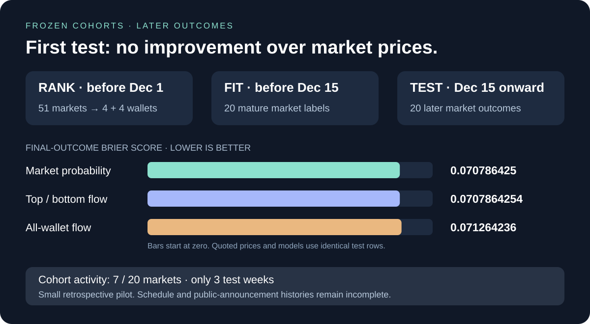

# Do earlier wallet rankings improve later forecasts?



**Result: no improvement over market prices in this pilot.** The fitted cohort adjustment is almost zero. This small retrospective experiment neither demonstrates predictive skill nor rules out useful signals with better coverage.

| Forecast on the same 20 test markets | Brier score ↓ | Log loss ↓ | Brier skill versus market ↑ |
| --- | ---: | ---: | ---: |
| Quoted market probability | 0.070786425 | 0.215821917 | 0 |
| All-wallet flow model | 0.071264236 | 0.216887164 | −0.006750042 |
| Top/bottom cohort model | 0.070786425446 | 0.215821918 | −0.0000000063 |

[Per-market forecasts](forecasts.csv) · [Fitted model](model.json) · [Summary](summary.json) · [Exclusions](excluded_markets.csv) · [Earlier wallet evidence](../../../finance-wallets/2025-12-01/v1/README.md)

## Frozen timeline

| Step | Rule | Usable evidence |
| --- | --- | ---: |
| Rank wallets | Labels strictly before December 1, 2025 UTC | 51 markets; 43 eligible wallets; four per decile |
| Fit flow-to-probability mapping | Prediction after ranking; label strictly before December 15 UTC | 20 markets |
| Test the frozen model | Prediction on/after December 15 UTC | 20 markets in three calendar weeks |
| Exclude unusable later markets | Forecast precedes cohorts or market already formally resolved at forecast | 9 markets |

The source's 51/26/23 **label-date counts** are not forecast counts. Evaluation splits follow prediction timestamps, then require training labels to have matured at fit time. The model cannot use any held-out label for fitting. Tests verify that changing a test outcome leaves fitted coefficients unchanged.

The prediction cutoff is the reported scheduled end minus 24 hours. Choose the latest YES-price bucket fully available by that cutoff, at most 24 hours old; exclude exact/settlement records. Price bucket availability is timestamp plus resolution, not the bucket start. Only trades strictly before prediction enter features.

Over the preceding seven days, BUY YES and SELL NO increase signed YES flow; BUY NO and SELL YES decrease it. Net each wallet's taker shares, divide by 1,000, clip to [−1,1], then average over the frozen cohort membership, counting inactive members as zero. The all-wallet comparator averages active nonzero wallet signals. This is observed recent flow, not reconstructed open inventory. Cohort activity occurs in only **7 of 20 test markets**.

Fit a logistic adjustment to market log odds with L2 penalty 0.1, no fitted intercept, and separate top/bottom coefficients. No signal gives exactly the quoted market probability. The all-wallet comparator uses the same fitting procedure with one flow feature. The bottom group's sign is learned on calibration data, not automatically inverted. Hyperparameters were not tuned after inspecting these test scores.

## Interpretation limits

Historical schedule snapshots and exact public announcement times are not fully collected. Reported schedules may have changed, and formal resolution can lag already-public outcomes. Thus this is a retrospective pipeline check, not a verified live-trading replay. Benchmark prices are sparse histories, not pre-trade order-book midpoints or guaranteed executable fills. The resolved-only market selection excludes still-open/unresolved events and cannot establish performance on that full population.

Four wallets per decile and three test calendar weeks do not support a robust block confidence interval; none is claimed. Economic-family grouping reduces obvious duplication but does not remove shared news shocks. This experiment evaluates final-outcome probabilities. It does not estimate portfolio returns or prices 24 hours later.

The next useful collection is **deeper pre-cutoff history for recurring wallets, plus exact outcome-publication and price-availability records**. Preserve this test as observed. Choose and freeze a new later test period before comparing revised thresholds or models.

```powershell
python -m polyresearch.backtest
python -c "from pathlib import Path; from polyresearch.artifacts import verify; print(verify(Path('analysis/finance-backtest/2025-12/v1')))"
```

Run from the repository root. Settings and source hashes are published alongside results; use a new `--out` when changing the experiment.
