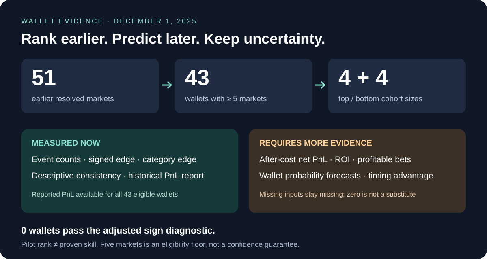

# Wallet evidence before December 1, 2025



**43 wallets are enough to exercise the pipeline. They are not enough to establish a reliable skilled/unskilled population.** Five earlier markets is a pilot eligibility floor. Each decile contains four wallets; the other 35 eligible wallets remain in the middle. The wider earlier-market population contains 8,790 observed addresses, including addresses with no taker evidence.

[Ranked cohorts](cohorts.json) · [All wallet metrics](wallet_metrics.csv) · [Category metrics](category_metrics.csv) · [Summary](summary.json) · [Later forecast results](../../../finance-backtest/2025-12/v1/README.md)

<details>
<summary>Tables, definitions and reproducibility</summary>

## What is measured?

| Metric | This snapshot | Meaning / benchmark |
| --- | --- | --- |
| Resolved market count | Measured | Earlier selected economic groups with taker evidence; not lifetime count |
| Market-relative edge | Measured | Signed settlement payoff per share, averaged equally across events |
| Reported realized PnL | Available for 43/43 eligible wallets | Latest provider observation strictly before cutoff; all-market scope |
| After-cost realized PnL and ROI | Missing | Requires reconciled closed positions, full costs and deployed capital |
| Directional win rate | Measured proxy | Dominant net YES/NO trade direction versus outcome; not profitable-position win rate |
| Profitable-position win rate | Missing | Requires reconciled closed positions |
| Consistency | Measured descriptive check | Earlier/later halves; at least three events per half; leave-one-event-out sensitivity |
| Category-specific edge | Measured | Counts and edge within each finance subcategory; small counts remain visible |
| Statistical significance | Exploratory diagnostic only | Event-sign randomization, joint BY adjustment; no validated skill discoveries |
| Individual wallet Brier skill | Missing | Needs explicit wallet probability forecasts and comparable market probabilities |
| Timing advantage | Deferred | Late-trade fraction is descriptive; it does not establish price leadership |

## Definitions that prevent misleading results

For token payout `y ∈ {0,1}` and execution price `p`, per-share edge is `y − p` for a buy and `p − y` for a sell. Share-weight within an event, then average equally across events. Repeated fills do not become independent successful bets. This payoff proxy is **not reconciled realized PnL**: inventory, redemptions, transfers, fees, rewards and split/merge operations are not fully reconstructed.

Zero edge is the ideal no-cost benchmark **if prices are calibrated conditional on the trading decision**. A raw positive outcome-price difference alone does not establish information skill; spreads, late entry, selection and liquidity provision matter. A comparable executable strategy must match markets, timestamps, size/exposure and costs. We have not reconstructed such a strategy here. Actual outcome divided by entry price is a payout multiple, not forecasting edge.

ROI uses `net PnL / explicitly supplied deployed capital`. Turnover and trading volume are not substitutes for that denominator. Profitable-position win rate counts positions with positive net PnL; directional accuracy counts whether an outcome prediction was right. Buying at 90 cents can give a high hit rate without beating the price-implied benchmark. The included expected-directional-win-rate field is a descriptive execution-price proxy, not a hypothesis test.

The ranking score is `mean_event_edge × n / (n + 10)`: a transparent zero-centered shrinkage heuristic. Eligibility is `n ≥ 5`. Rank descending, break exact ties lexicographically by wallet address, and take `floor(0.10 × eligible_count)` at each end. The shrinkage weight is an engineering choice, not a fitted Bayesian posterior. **Neither decile is named skilled or unskilled.** Provider-reported lifetime PnL is retained as a separate axis and does not determine this ranking.

## Significance and persistence

The diagnostic randomizes each wallet's event-edge sign, exactly for up to 16 events, otherwise with 20,000 seeded draws and a plus-one Monte Carlo correction. It assumes event-sign symmetry. It is not a calibrated-price outcome null, a feasible capital-constrained strategy simulation, or a replication of the Yale/SSRN procedure. Event grouping reduces obvious ladder duplication but does not establish independence. BY adjustment is conservative about dependence **only when the underlying p-values are valid**.

No eligible wallet has diagnostic BY-adjusted `q ≤ .05`. All `statistical_skill` fields remain `not_established`. Five positive equal-sized events produce two-sided sign-test `p = .0625` even before testing many wallets. No positive skill label should be inferred from this pilot.

Historical halves describe consistency; they do not provide a second independent validation after ranking on both halves. The [later-market experiment](../../../finance-backtest/2025-12/v1/README.md) supplies the separate prediction evaluation.

The primary [Who Calibrates Markets? working paper](https://kalshi.com/research/kalshi-research-who-calibrates-markets.pdf) separates forecasting accuracy from profitability and uses execution-price belief proxies versus pre-trade midpoints. Our sparse histories lack those midpoint controls; buying a token is not evidence of a 100% subjective probability. A top 5% or top 10% rank is a cohort rule, not a statistical significance threshold. The [Gómez-Cram et al. author interview](https://blog.ssrn.com/2026/06/29/a-closer-look-prediction-market-accuracy-crowd-wisdom-or-informed-minority-by-roberto-gomez-cram-yunhan-guo/) motivates comparing performance with randomized strategies; the diagnostic above makes a narrower claim.

## Reproduce from the repository root

```powershell
python -m polyresearch.wallet_metrics --enrich-pnl
python -m polyresearch.backtest
python -c "from pathlib import Path; from polyresearch.artifacts import verify; print(verify(Path('analysis/finance-wallets/2025-12-01/v1')))"
```

Cached raw responses are reused. Use a new `--out` for changed settings or evidence. PnL source: `GET https://data-api.polymarket.com/v2/user-pnl?user=<wallet>&interval=max&fidelity=1d`. The `raw/pnl/` files retain full returned series, **including later dates** for audit. Calculations select only timestamps strictly before December 1; never train directly on full raw series. These are retrospective provider histories collected November 7, 2026, not archived responses captured in 2025. Source revisions and coverage gaps remain possible.

`manifest.json` hashes generated payloads and their source metadata/code. Run the source dataset's verifier separately to check all underlying market payloads. The ranking is restricted to selected-market taker evidence; it does not investigate every wallet's complete prior trading history.

## Supplying the missing evidence

`--evidence path/to/audited.json` accepts the following structure. This is a **schema illustration with fictional values**, not measured wallet evidence. Wallet addresses must match the source dataset; timestamps below illustrate ordering only.

```json
{
  "closed_positions": [{
    "wallet": "0x...", "opened_at": 10, "closed_at": 20, "available_at": 21,
    "reconciled": true,
    "proceeds_usdc": 120, "cost_basis_usdc": 100,
    "fees_usdc": 2, "other_costs_usdc": 1, "capital_deployed_usdc": 100
  }],
  "forecasts": [{
    "wallet": "0x...", "economic_cluster_id": "event-1",
    "market_quote_at": 10, "market_quote_available_at": 11, "issued_at": 12,
    "outcome_available_at": 20, "wallet_probability": 0.7,
    "market_probability": 0.5, "outcome": 1
  }]
}
```

Cost basis excludes separately supplied fees/other costs. Only closed, available, explicitly reconciled positions enter the supplied-position metrics. That does not establish complete lifetime coverage or portfolio time-weighted ROI. Forecasts must use an already available quote and precede the outcome; labels must mature before the ranking cutoff. Forecast rows receive equal total weight per economic group. Brier skill is `1 − wallet_Brier / market_Brier` on those identical observations; it is undefined when benchmark Brier is zero.

</details>
