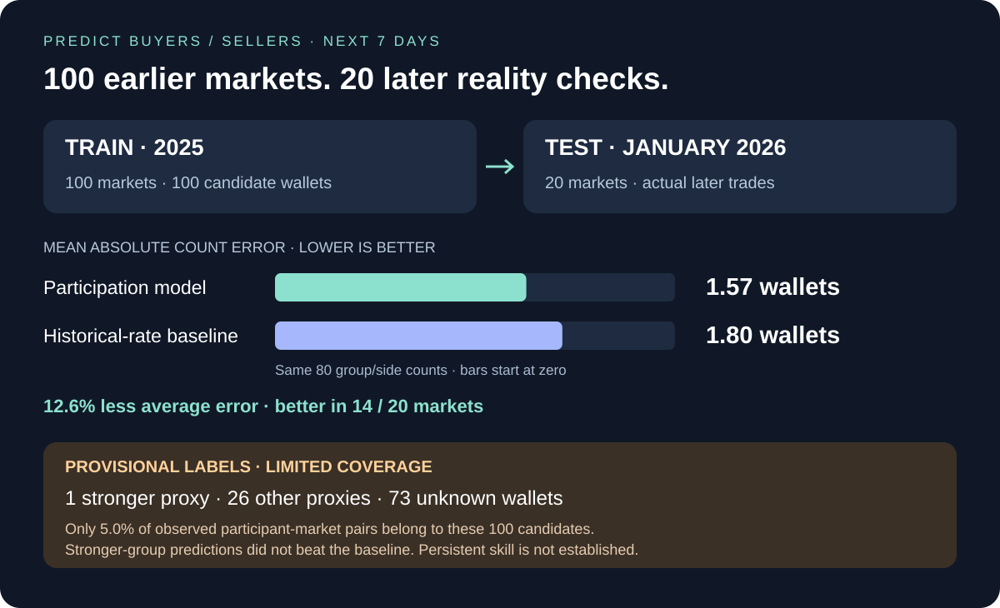

# Predict next-week buyer/seller counts



**The first model reduced average count error, but the sample does not establish reliable skilled-wallet predictions.** Its main improvement came from the other-performance group; the one-wallet stronger group did not beat the historical-rate baseline.

[Predicted versus actual counts](predictions.csv) · [Per-market errors](per_market_errors.csv) · [Per-week errors](per_week_errors.csv) · [Wallet groups](candidate_wallets.csv) · [Summary](summary.json) · [Model](model.json)

## Earlier data → frozen model → later actual trades

| Stage | Evidence |
| --- | --- |
| Earlier market sample | [100 resolved Finance markets from 2025](../../../../datasets/finance/resolved-100-2025/v1/README.md) |
| Wallet return evidence | [Position economics for those 100 markets](../../../../datasets/finance/position-evidence-100-2025/v1/README.md) |
| Candidate universe | Top 100 earlier wallets by distinct markets, chosen using only evidence before January 1, 2026 UTC |
| Training observations | 280 seven-day windows across all 100 markets; 1,680 group/side count rows, **not 1,680 independent markets** |
| Model cutoff | January 1, 2026 UTC; all training trade windows end by that instant |
| Later evaluation | [20 separately collected resolved Finance markets from January 2026](../../../../datasets/finance/resolved-20-2026-01/v1/README.md); no overlapping economic-group IDs |
| Forecast horizon | Next seven days, as requested |

For each earlier market, start forecasting after its first 24 hours (or August 1, 2025 if later), then advance in nonoverlapping seven-day steps while the market is open. Only windows fully observable by the model cutoff can train the model. Historical candidate wallets become eligible in an example only after their first earlier observed trade; future participants are not used to create the example's candidate list. The fixed candidate universe itself is selected from the entire training period, not from 2026 participation.

For each later market, make one prediction at the later of January 1 and its opening plus 24 hours. Each wallet group is computed from earlier evidence strictly available at that prediction time and stays fixed for its seven-day label window. If a market closes during the window, there are no later trading opportunities; actual counts stop at closure. Actual shorter exposure is retained for audit but is **not** a model input. Schedules and historical closure metadata remain retrospective collection-time records.

## The four requested counts

Count unique wallets buying or selling **either token**, not transactions. Keep the two token identities in [observed_token_counts.csv](observed_token_counts.csv). Buying NO is a BUY transaction but carries the opposite YES-directional exposure from buying YES. A wallet can appear in both buyer and seller counts; the counts are not mutually exclusive participant totals.

| Requested group (provisional) | Model MAE ↓ | Historical-rate MAE ↓ | Actual action/market count sum |
| --- | ---: | ---: | ---: |
| Skilled proxy: buyers + sellers | 0.374 | 0.368 | 10 |
| Unskilled proxy: buyers + sellers | 2.767 | 3.224 | 152 |
| **Four requested counts together** | **1.571** | **1.796** | **162** |
| Unknown: reported separately | 2.626 | 3.146 | 146 |

MAE is the mean absolute difference between predicted and observed wallets for each group/side count. There are 80 requested count predictions: 20 markets × 2 groups × 2 sides. Summed counts repeat wallets across markets and can repeat buyers as sellers; 162 does not mean 162 distinct people. Expected counts can be fractional.

For the four requested counts, historical rates give MAE 1.796, recent seven-day count persistence 2.075, and always predicting zero 2.025. The model's 1.571 is **12.6% lower than the historical-rate error** in this test. It improves on that baseline in 14/20 markets and all three prediction calendar weeks. Three weeks and 20 markets are too few for a robust claim of persistent skill; no confidence interval or significance claim is made. These results do not validate the group labels themselves.

Example from market `1032307` (actual counts from its test window):

| Group | Action | Predicted | Observed |
| --- | --- | ---: | ---: |
| Skilled proxy | BUY | 0.67 | 1 |
| Skilled proxy | SELL | 0.63 | 1 |
| Unskilled proxy | BUY | 6.64 | 14 |
| Unskilled proxy | SELL | 2.20 | 7 |

This example illustrates substantial per-market error even when aggregate MAE improves.

## What does skilled/unskilled mean in this pilot?

The user's above-average-winner idea is implemented as an explicit **return-proxy baseline**, not verified ROI:

1. For each earlier wallet-market, sum provider-reported realized PnL across its outcome tokens. Divide by the estimated cumulative acquisition basis `sum(total_size × avg_price)`.
2. At prediction time, consider only rows whose market has resolved and whose last economics event precedes that time. Current future-updated positions cannot serve as earlier labels. For each earlier market, calculate mean proxy return among positive-PnL participants with usable evidence. No positive peers means no comparison evidence from that market.
3. A wallet receives an above-winner-mean observation if its return exceeds that market's positive-peer mean. With at least **five comparable earlier markets**, label it `skilled_proxy` if more than half its observations exceed their peer mean; otherwise `unskilled_proxy`. Insufficient history stays `unknown`. Exact ties do not qualify as above-average.

At model fit, the 100 candidates comprise **1 skilled proxy, 26 unskilled proxies and 73 unknowns**. This is a strict and uneven split, retained rather than changing the rule after seeing test performance. Return data is incomplete for many active wallets. A below-threshold profitable wallet may fall in the second group; “unskilled” is a working label and does not establish lack of ability. Neither group is statistically proven skill.

The denominator is an estimate based on provider position fields, not a reconstructed deployed-capital ledger. Fees, transfers, split/merge accounting and lifetime coverage are not independently reconciled. Raw API percentage fields are not silently treated as ROI. Full after-cost ROI grouping remains a separate accounting task.

## Model and coverage

The model uses recent group participation fraction, recent all-wallet activity, market age, reported remaining scheduled time and Finance subcategory. Scaling is fitted on training rows only. Each group/side has a regularized binomial count model, with a pooled-side fallback if the earlier group has no examples. Expected counts are constrained to the group's eligible candidate size. The historical-rate baseline is fitted on the same earlier examples. Model parameters are saved before constructing held-out labels; tests verify that changing later labels leaves fitted parameters unchanged. No parameter search was performed after reading these test scores.

Only **248 of 4,987 observed participant-market pairs** in these windows belong to the candidate universe, about **5.0%**. The remaining 4,739 are explicitly outside scope, not zero participants or automatically unskilled wallets. Unknown performance labels within the 100 candidates are predicted separately. Thus this is a **100-wallet participation model**, not a forecast of all wallets in arbitrary Finance markets.

Resolved-only sampling, shared economic news, dependent training windows, retrospective provider revisions and a very small stronger group limit generalization. Freeze a new later evaluation before changing the label rule, candidate universe or model. The earlier [YES/NO-outcome experiment](../../../finance-backtest/2025-12/v1/README.md) is a separate task and is not used as evidence for participation performance.

## Reproduce

```powershell
# Cached position pages are reused.
python -m polyresearch.position_evidence
python -m polyresearch.participation
python -m unittest discover -s tests -v
python -c "from pathlib import Path; from polyresearch.artifacts import verify; print(verify(Path('analysis/participation/2026-01/v1')))"
```

Run from the repository root. Source hashes, settings, model coefficients, training counts and held-out observations are published. Use a new `--out` for a changed experiment.
