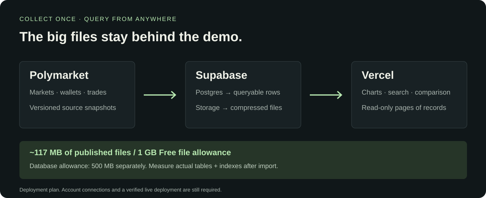

# Datasets

**[Visual catalog →](../docs/data-catalog.md)** · [Interactive demo guide](../web/README.md)

| Field | Market | Snapshot |
| --- | --- | --- |
| Finance | 100 resolved markets; verified historical labels | [Explore resolved v1 →](finance/resolved-100-2025/v1/README.md) |
| Finance | 20 later markets; January 2026 evaluation | [Explore later sample →](finance/resolved-20-2026-01/v1/README.md) |
| Finance | Position economics and provisional returns | [Explore evidence →](finance/position-evidence-100-2025/v1/README.md) |
| Finance | Anthropic IPO closing market cap: $1.25T–$1.5T | [Explore v1 →](finance/anthropic-ipo-1_25t-1_5t/v1/README.md) |

Each published snapshot includes cleaned tables, original API responses, a manifest, SHA-256 checksums, and validation results. Local experiments stay in the ignored `data/` directory.
