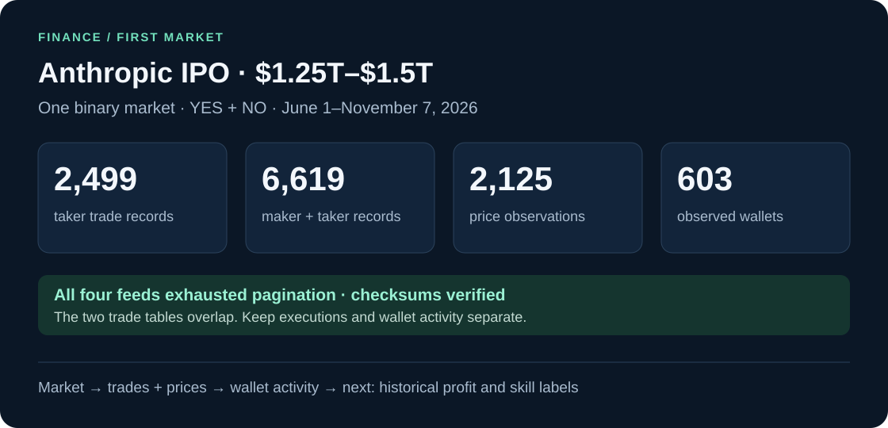

# Anthropic IPO · $1.25T–$1.5T · v1

[Market →](https://polymarket.com/event/anthropic-ipo-closing-market-cap-higher-strikes/will-anthropics-market-cap-be-between-1pt25t-and-1pt5t-at-market-close-on-ipo-day)



**One binary question:** Will Anthropic's market cap be between $1.25T and $1.5T at market close on IPO day?

This snapshot contains **only this bracket's YES and NO outcomes**. The market opened June 1, 2026, so there is no August–December 2025 history for it.

## Open the data

| File | Rows | Use |
| --- | ---: | --- |
| [trades.csv.gz](trades.csv.gz) | 2,499 | Taker-side execution records; start here for trade activity |
| [wallet_trade_legs.csv.gz](wallet_trade_legs.csv.gz) | 6,619 | Maker + taker wallet activity; start here for wallet behavior |
| [prices.csv.gz](prices.csv.gz) | 2,125 | Available historical YES and NO price observations |
| [wallets.csv](wallets.csv) | 603 | Per-wallet activity summaries for this market |
| [outcomes.csv](outcomes.csv) | 2 | YES/NO token IDs |
| [market.json](market.json) | 1 market | Identifiers, dates and resolution rules |
| [coverage.csv](coverage.csv) | 4 feeds | First/last observations and pagination status |
| [raw/](raw/) | 5 archives | Original metadata, trade and price collection responses |

```text
                     THIS MARKET
                          │
              ┌───────────┴────────────┐
            TRADES                  PRICES
              │                    YES + NO
       ┌──────┴──────┐
    Taker side    Both sides
      2,499         6,619
                      │
                603 wallets
```

**The two trade tables overlap. Do not add their row counts or notionals together.** The all-wallet table includes maker and taker records, and those records are not unique executions. Individual row roles are not exposed by the API.

## Dates and coverage

**Window:** June 1, 2026, 00:00 UTC ≤ observation time &lt; **November 7, 2026, 17:49:10 UTC**.

| Month | Taker trade records |
| --- | ---: |
| June | 215 |
| July | 73 |
| August | 332 |
| September | 339 |
| October | 988 |
| November, through snapshot | 552 |

All four feeds exhausted pagination. No missing observations were filled with invented values. Exhausting pagination describes the API traversal, not guaranteed complete on-chain history. Prices use requested three-hour buckets; observations are sparse and their actual `resolution_seconds` is preserved.

## Read a few rows

Gzip files contain ordinary CSVs. From the repository root:

```python
import csv
import gzip
from itertools import islice

path = "datasets/finance/anthropic-ipo-1_25t-1_5t/v1/trades.csv.gz"
with gzip.open(path, "rt", encoding="utf-8", newline="") as file:
    for trade in islice(csv.DictReader(file), 3):
        print(trade)
```

Keep wallet addresses, condition IDs, token IDs and transaction hashes as **strings**, especially in spreadsheets.

## Column guide

| Table | Useful columns |
| --- | --- |
| Trades / wallet legs | `timestamp` = Unix seconds; `wallet` = address; `side` = BUY/SELL from that wallet's perspective; `size_shares`; `price` = 0–1; `notional_usdc = size_shares × price` |
| Prices | `token_id`, `outcome`, `timestamp`, `price`, `resolution_seconds`, `available_at` |
| Wallets | `market_trade_leg_rows`, `taker_trade_rows`, `first_seen`, `last_seen`, `buy_notional_usdc`, `sell_notional_usdc`, `yes_signed_flow_usdc` |

`yes_signed_flow_usdc` adds BUY YES and SELL NO cash flow, and subtracts BUY NO and SELL YES cash flow. It is a directional-flow heuristic, not a holdings balance or trading profit. Wallet counts and notionals describe this market's observed activity only.

**For later modeling:** aggregates are usable only at `available_at = timestamp + resolution_seconds`; points unavailable by the frozen cutoff are excluded from cleaned prices. Collection-time metadata such as `closed_now` is not a historical feature. Exact settlement points must not enter pre-resolution features. Raw trade archives may contain observations after the frozen cutoff; use the cleaned tables for this snapshot. Raw API pages also include public profile fields omitted from the cleaned tables. Identical trade records are retained because transaction hashes alone are not unique fill IDs.

Historical wallet profit and skill labels are **not assigned yet**. They require wallet history from before each prediction cutoff. The market is unresolved in this snapshot, so there is no final outcome label.

## Verify / refresh

```powershell
# Verify this published snapshot, without network access.
.\.venv\Scripts\python.exe -m polyresearch.market_dataset --verify-only

# Collect the same market into a NEW local snapshot.
.\.venv\Scripts\python.exe -u -m polyresearch.market_dataset --out data/anthropic-refresh
```

[Validation results](validation.json) · [Manifest + SHA-256 checksums](manifest.json) · [Collection settings](config.json)

Sources: [Polymarket market](https://polymarket.com/event/anthropic-ipo-closing-market-cap-higher-strikes/will-anthropics-market-cap-be-between-1pt25t-and-1pt5t-at-market-close-on-ipo-day), [Gamma](https://docs.polymarket.com/market-data/discover-markets), [Data API v2 schema](https://data-api.polymarket.com/v2/openapi.json). Source data belongs to its respective providers; this repository grants no additional rights to that data.
