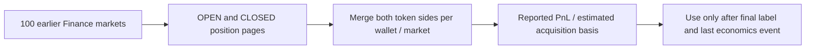

# Earlier wallet position evidence



**100 markets collected; 4,993 wallet-market rows, including 4,822 usable return estimates and 3,692 distinct wallets.** These are retrospective provider economics, not independently reconciled wallet accounts. Active addresses absent from this feed do not receive zero returns.

[Summary](summary.json) · [Normalized returns](wallet_market_returns.csv.gz) · [Configuration](config.json) · [Errors](errors.json) · [SHA-256 manifest](manifest.json) · [Participation results](../../../../analysis/participation/2026-01/v1/README.md)

Public source: [`GET /v2/positions`](https://data-api.polymarket.com/v2/openapi.json), queried separately for `CLOSED` and `OPEN` by condition with page size 1,000. OPEN requests also include archived positions. The default OPEN/CLOSED dust boundary is preserved consistently. All cursor pages are retained in `raw/<market_id>.json.gz`, with query parameters and collection timestamps. Inactive/unservable markets and nonnative position accounting can still reduce coverage. No API key is needed.

Token rows appearing in both lifecycle walks are deduplicated by wallet/token; conflicting native economics cause an error. Both YES and NO tokens are merged before computing each wallet-market row. The numerator is summed `realized_pnl`. The denominator is `sum(total_size × avg_price)`, an **estimated cumulative acquisition basis**, not cash currently invested, trading volume, deployed-capital ROI or full portfolio return. It does not establish all-cost profitability. Missing or invalid economics and zero/tiny basis remain unusable.

Do not use current marks, `percent_pnl` or `percent_realized_pnl` as historical after-cost ROI. The API schema's compatibility percentage definitions differ from that quantity, and a snapshot alone does not reconcile the ledger. The derived ratio is deliberately named `reported_return_proxy`.

`available_at = max(market final-label timestamp, all token rows' last_event_at)`. First acquisition and last-event clocks must be nonzero and ordered. A position snapshot updated in 2026 cannot be imported into a 2025 label. This conservative filter does not reconstruct the position's earlier state; it leaves that evidence unavailable until its last economics timestamp. Collection is retrospective on November 7, 2026; historical state revisions or late indexing remain possible.

The [participation analysis](../../../../analysis/participation/2026-01/v1/README.md) applies the above-winner-mean rule to these proxies and keeps insufficient histories unknown. This snapshot does not replace the existing wallet-metric files' missing reconciled ROI values.

```powershell
python -m polyresearch.position_evidence
python -c "from pathlib import Path; from polyresearch.artifacts import verify; print(verify(Path('datasets/finance/position-evidence-100-2025/v1')))"
```

Cached raw pages are reused. Source: [100-market 2025 snapshot](../../resolved-100-2025/v1/README.md). The manifest hashes raw pages, derived payloads and source metadata/code; README changes do not alter payload hashes.
