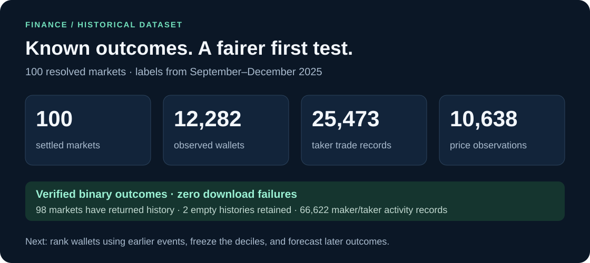
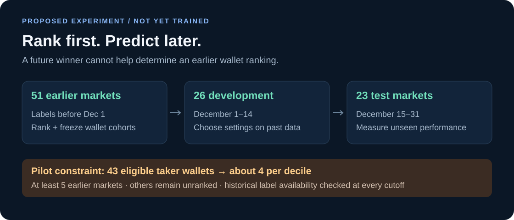

# Finance · 100 resolved markets · v1



**Start:** [Markets + final outcomes](markets.csv) → [Wallet index](wallets.csv) → [Per-market tables](markets/) → [Coverage](coverage.csv)

This is the earlier dataset for the [implemented next-week participation test](../../../../analysis/participation/2026-01/v1/README.md). It also supports a separate [earlier outcome-forecasting experiment](../../../../analysis/finance-backtest/2025-12/v1/README.md).

<details>
<summary>Tables, definitions and reproducibility</summary>

## What's collected

| Data | Count |
| --- | ---: |
| Selected settled markets | 100 |
| Distinct Gamma parent events | 100 |
| Distinct heuristic economic families | 100 |
| Markets with returned trades and prices | 98 |
| Distinct observed maker/taker wallets | 12,282 |
| Taker trade records | 25,473 |
| Maker + taker activity records | 66,622 |
| Price observations across YES + NO | 10,638 |
| Failed downloads | 0 |

The two trade tables overlap. **Never add their notionals or row counts as unique market executions.** Coverage means records returned by the API, not guaranteed complete on-chain history or complete lifetime wallet activity.

Selection sought final labels available during **August–December 2025**, following the original research window. The selected labels actually range from **September 1 to December 31, 2025**. All observations were reconstructed in a November 7, 2026 snapshot.

| Resolution month | Selected markets |
| --- | ---: |
| September | 5 |
| October | 13 |
| November | 33 |
| December | 49 |

## Files

| Path | Contents |
| --- | --- |
| [markets.csv](markets.csv) | One row per selected market: IDs, economic group, question, dates, verified `yes_outcome`, conservative `label_available_at`, source flags, and folder |
| [wallets.csv](wallets.csv) | Combined wallet index; observed market counts and activity counts within this sample |
| [coverage.csv](coverage.csv) | Per-market row counts and pagination status |
| [raw/selection.json.gz](raw/selection.json.gz) | Selected market metadata, source resolution responses and selection audit |
| [raw/discovery.json.gz](raw/discovery.json.gz) | Broader discovery frame used to select the 100 markets; retrospective metadata, not model features |
| [markets/](markets/) | A separate folder for each of the 100 market IDs |

Every market folder contains:

```text
market.json                 question, rules, lifecycle metadata
outcomes.csv                YES / NO outcome tokens
trades.csv.gz               taker-side execution records
wallet_trade_legs.csv.gz     maker + taker wallet activity
prices.csv.gz               historical outcome prices + availability times
wallets.csv                 activity summaries in this market
coverage.csv                source ranges and pagination flags
raw/*.json.gz               original collection responses
manifest.json               payload SHA-256 checksums
validation.json             checks and results
```

The two empty-history markets, IDs `691510` and `646594`, remain in the selection. Missing rows are not filled with zeros, and no replacements were chosen after observing data availability.

## How the sample was selected

```text
Finance-tagged discovery frame
              │
     final binary resolution
              │
 actual label timestamp in Aug–Dec 2025
              │
 at least 7 days from trading start to closure
              │
 seeded hash order + finance-subfield rotation
              │
 one market per parent event + economic family
              │
     100 markets → all returned wallets
```

Final resolution status and payouts/UMA prices were checked against Data API v2 and reconciled with Gamma's binary outcomes. Fractional/50–50, unverified, conflicting, and out-of-window resolutions were excluded. `label_available_at` is the later of Gamma's closure time and the source's resolved timestamp or last resolved-lifecycle update. Where original publication latency is unavailable, this is a conservative reconstruction, not a guarantee of the exact first historical publication time.

The economic-family heuristic groups duplicate asset/week price ladders, detected IPO/acquisition families, company rankings and same-day Fed decision families across parent IDs. These rules **do not guarantee statistical independence**. Company aliases, earnings announcements, shared macro news and other dependencies still require event/time blocking in evaluation. The selection audit records 31 rejected repeated families and 71 repeated-parent candidates.

Composition: 73 equities/corporate, 15 IPOs/deals, 8 rates/macro, 3 ETFs/digital finance, and 1 commodity market. These are title-derived categories. The minimum-duration rule excludes many short markets, and the rotation over available categories is not a representative random sample of all Finance trading. Current tags/rules may differ from their historical versions. No market was selected for its winner, trading volume or wallet profits.

## Rank earlier, evaluate later



Candidate schedule, before looking at forecast performance:

| Phase | Resolution-label availability | Markets |
| --- | --- | ---: |
| Earlier ranking history | Before December 1 | 51 |
| Development | December 1–14 | 26 |
| Final test | December 15–31 | 23 |

This is a proposed protocol, not completed model training. At **each forecast time**, rankings must use only earlier available labels; the table alone does not guarantee that. Later markets can overlap earlier markets' trading lifetimes. Use past calendar cutoffs and public event-announcement timing; do not create forecasts after the outcome was already knowable but before slow oracle settlement.

At the December 1 boundary, 93 wallets have activity in at least five earlier selected markets. Restricting that evidence to taker activity leaves **43 wallets**, or **four wallets per decile** when taking `floor(10%)`. Across the entire snapshot, 183 wallets appear in at least five markets; that future-inclusive count must not determine earlier eligibility. A five-event floor is a pilot setting, not evidence of statistically established skill. Most wallets remain unranked with this limited history.

The next step is an exploratory, price-adjusted, event-normalized ranking, followed by held-out testing. Complete net P&L needs fees, inventory, transfers and split/merge/redemption reconstruction; this snapshot does not provide a reliable lifetime profit ranking.

[Detailed backtest protocol →](../../../../docs/research/resolved-market-backtest.md)

## Read / verify

CSV IDs are strings. Read compressed tables with standard Python:

```python
import csv
import gzip
from pathlib import Path

root = Path("datasets/finance/resolved-100-2025/v1")
with (root / "markets.csv").open(encoding="utf-8", newline="") as file:
    market = next(csv.DictReader(file))
with gzip.open(root / market["folder"] / "trades.csv.gz", "rt", encoding="utf-8") as file:
    trades = list(csv.DictReader(file))
```

From the repository root:

```powershell
.\.venv\Scripts\python.exe -m polyresearch.resolved_dataset --verify-only

# A fresh reconstruction; source APIs can change after this snapshot.
.\.venv\Scripts\python.exe -u -m polyresearch.resolved_dataset --out data/resolved-100-refresh
```

For historical features, require prices to be fully available at the prediction cutoff (`available_at`), and exclude settlement points. The API can synthesize terminal payout points for resolved markets; preserve them in raw data but never use them to predict that outcome. Use three-hour aggregates conservatively and flag sparse/stale observations. Keep final payouts and all collection-time metadata out of feature columns.

[Manifest](manifest.json) · [Validation](validation.json) · [Settings](config.json) · [Download errors](errors.json)

Sources: [Polymarket Finance](https://polymarket.com/finance), [resolution documentation](https://docs.polymarket.com/concepts/resolution), [Data API v2](https://data-api.polymarket.com/v2/openapi.json). Source data belongs to its respective providers; no additional rights are granted here.

</details>
