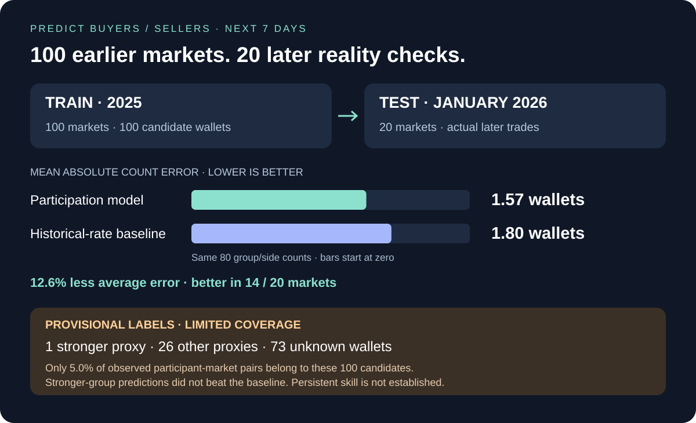

# Later evaluation: 20 resolved Finance markets



**January 2026 test sample**, separate from the 100 earlier markets. Used to observe actual later buyer/seller counts for the [seven-day participation test](../../../../analysis/participation/2026-01/v1/README.md).

| Evidence | Count |
| --- | ---: |
| Selected / successfully downloaded markets | 20 / 20 |
| Distinct Gamma events / heuristic economic groups | 20 / 20 |
| Observed wallets | 40,165 |
| Taker trade records | 121,842 |
| Maker + taker activity records | 310,061 |
| Price observations | 3,801 |
| Payload checksums verified | 307 |
| Download errors | 0 |

[Market index](markets.csv) · [Wallet index](wallets.csv) · [Coverage](coverage.csv) · [Validation](validation.json) · [Manifest](manifest.json)

<details>
<summary>Tables, definitions and reproducibility</summary>

Selection follows the earlier snapshot's fixed hash seed, category rotation, one market per Gamma event and conservative economic-family grouping. Require verified final binary labels in `[2026-01-01, 2026-02-01)` UTC and at least seven days of reported trading lifetime. Neither observed future profits nor model errors determine selection. The participation program also rejects economic-group overlap with the earlier dataset. No tuning of selected markets occurred after reading prediction errors.

Discovery is retrospective and resolved-only; this does not represent all live Finance markets or independent economic shocks. Historical schedules, metadata and public outcome-announcement times are not fully archived. For this task, the held-out labels are later **trade participation counts**, not these markets' final YES/NO outcomes.

Taker records overlap the maker+taker table. Do not add them to obtain trade volume. Wallets are observed API addresses, not identified people. One large market required resuming its activity cursor after the first 250-page limit; the final 1,000-page budget allowed all feeds to exhaust. Earlier cached pages were retained and filters preserved. No partial feed is treated as zero activity.

```powershell
python -m polyresearch.resolved_dataset --verify-only --out datasets/finance/resolved-20-2026-01/v1

# Use a new directory for a fresh collection.
python -m polyresearch.resolved_dataset --out data/january-2026-fresh --source-catalog data/january-catalog.json.gz --count 20 --start 2026-01-01 --end 2026-02-01 --max-pages 1000
```

The manifest includes exact raw discovery/selection pages, per-market raw trades/prices and normalized tables. Keep compressed data files compressed; they preserve the audit trail without loading large JSON pages into a notebook at once.

</details>
