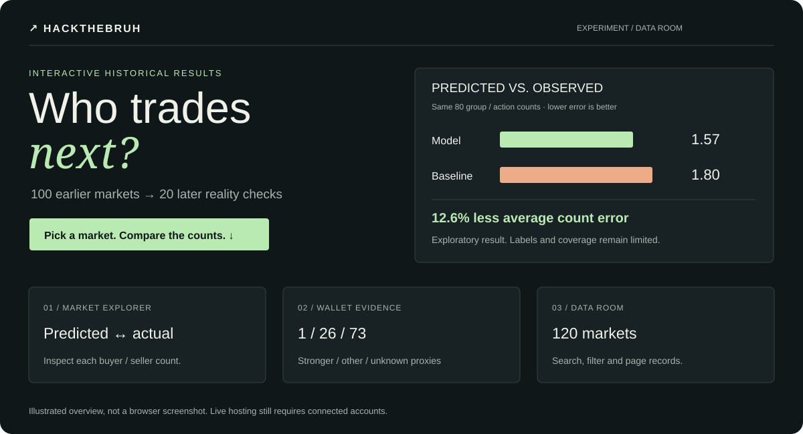
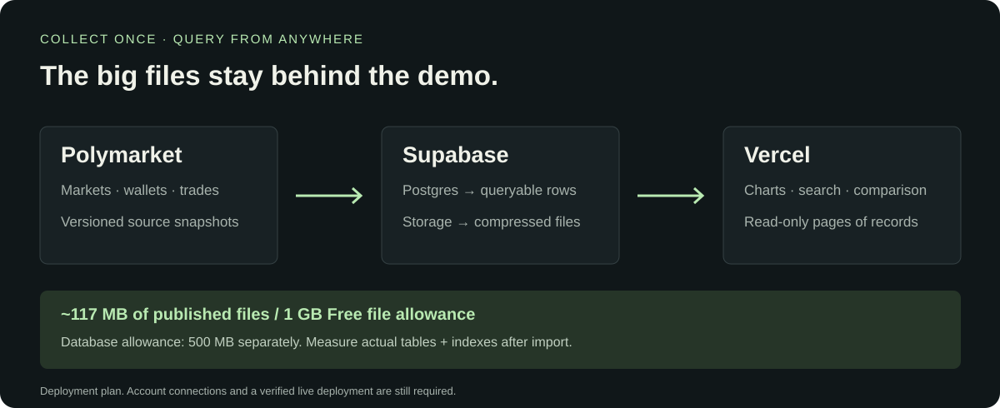

# Explore → inspect → reproduce

| See it | Go deeper |
| --- | --- |
| **[Interactive demo](../web/README.md)** | Market picker · prediction charts · searchable data room |
| **[Measured results](../analysis/participation/2026-01/v1/README.md)** | Predictions versus actual next-week counts |
| **[Dataset catalog](data-catalog.md)** | Earlier markets · later markets · return evidence |
| **[Supabase + Vercel](deployment.md)** | Migration · import · public demo configuration |

Research definitions and earlier experiments

- [Current participation target](research/wallet-participation-target.md)
- [Wallet-skill literature](research/wallet-skill.md)
- [Earlier outcome experiment](research/resolved-market-backtest.md)
- [Methodology and API notes](methodology.md)

