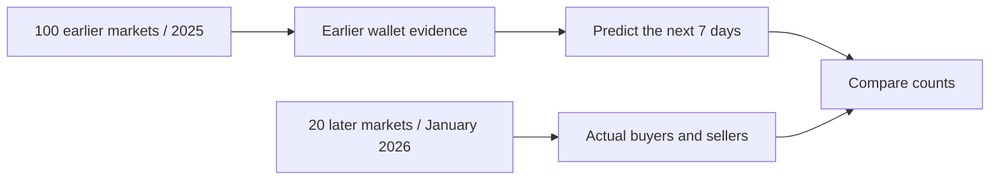
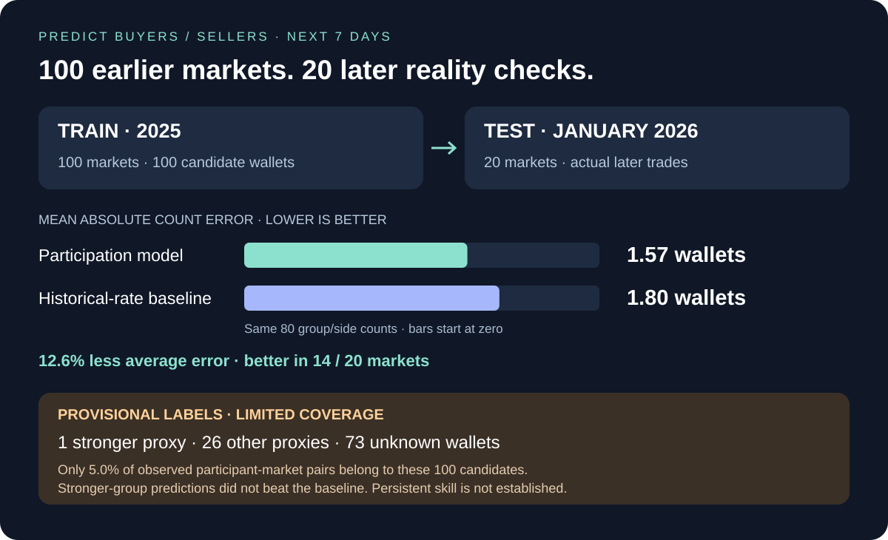

# The data, at a glance



| Open | Inside |
| --- | --- |
| [100 earlier markets](../datasets/finance/resolved-100-2025/v1/README.md) | 66,622 activity records · 12,282 observed wallets |
| [20 later markets](../datasets/finance/resolved-20-2026-01/v1/README.md) | 310,061 activity records · 40,165 observed wallets |
| [Position evidence](../datasets/finance/position-evidence-100-2025/v1/README.md) | 4,993 wallet-market rows · 4,822 usable proxies |
| [Predictions and actual counts](../analysis/participation/2026-01/v1/README.md) | 120 group/side rows, including unknowns |
| [Active-wallet IDs](../analysis/active-finance-wallets/README.md) | Earlier-only and year-end candidate lists |
| [Anthropic example](../datasets/finance/anthropic-ipo-1_25t-1_5t/v1/README.md) | Original single-market collection |



The web preview bundles about 146 KB of metadata and results. Full published files total about 117 MB. Supabase mode queries bounded pages; visitors need neither a Git clone nor the full archive. Existing Git snapshots remain reproducible archives until cloud import is verified.

<details><summary>Read from Python without local market files</summary>

After cloud import, set `SUPABASE_URL` and `SUPABASE_PUBLISHABLE_KEY` in the process environment:

```powershell
python -m polyresearch.remote markets
python -m polyresearch.remote trades --dataset finance-2026-01-v1 --market 1032307
```

```python
from polyresearch.remote import query
for trade in query("trades", dataset="finance-2026-01-v1", market="1032307"):
    pass  # Process records as pages arrive; no archive download/cache required.
```

Network reads still transfer requested rows. Existing training scripts use local files; moving training compute to a hosted job is a separate step. Vercel serves the explorer rather than long-running training.

</details>
