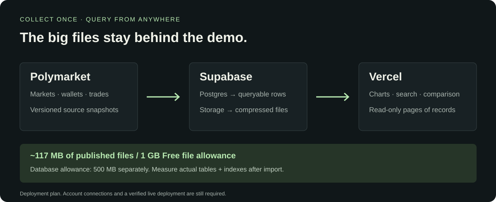
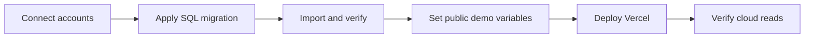

# Supabase data → Vercel demo



**Schema applied; import and website pending.** The migration succeeded in [the research project](https://supabase.com/dashboard/project/ivralczjtnfytxfzgpwc) on November 7, 2026. Import preflight could not reach the Supabase API, before uploading files or inserting rows. Vercel has not been deployed. The requested tab-level browser connection currently reports unavailable; whole-window automation is off.

| Free limit | Workload / meaning |
| --- | --- |
| Database: **500 MB per project** | Measure actual tables + indexes after import |
| Files: **1 GB** | Current archive approximately **117 MB** |
| Individual upload: **50 MB** | Largest current file **27.5 MB** |
| Egress: **5 GB + 5 GB cached** | Separate allowances; avoid full-archive requests |
| Inactivity | Free projects may pause after **one week** |
| Vercel Hobby | Personal, noncommercial use |

Checked November 7, 2026: [Supabase pricing](https://supabase.com/pricing), [file limits](https://supabase.com/docs/guides/storage/uploads/file-limits), [Vercel Hobby](https://vercel.com/docs/plans/hobby). The 117 MB artifact collection and approximately 97 MB JSONL export are **not database disk-size measurements**.



<details open><summary>1 · Schema and one-time import</summary>

Use a dedicated Free research project. Apply [the migration](../supabase/migrations/202611070001_research.sql) through the Supabase integration or SQL editor. It creates `research_*` tables with row-level security: visitors have SELECT only; the importer uses `service_role`. Incomplete datasets/experiments remain hidden from the demo.

```powershell
python -m polyresearch.cloud          # Offline validation/export only
python -m polyresearch.cloud --apply  # Migrated project + server credentials required
```

The importer reads `SUPABASE_URL` and `SUPABASE_SERVICE_ROLE_KEY` from the process environment. It does not automatically load `.env`. Use a connected service or local secret mechanism; do not put administrative keys in the demo. [`.env.example`](../.env.example) contains names only.

The ignored export `data/cloud-export/plan.json` reports 376,683 trades, 14,439 prices, 50,869 addresses, 4,993 return rows, 100 candidates and 120 predictions. Taker rows are flags, not duplicated activity. Identical legitimate fills are retained. Original files retain transaction/token fields omitted from lean SQL rows.

Public GitHub artifacts go to a dedicated public bucket, `hackthebruh-research`, under content-addressed SHA-256 paths. Existing private buckets are not made public. Snapshot hashes must match on retries. Row counts are verified with HEAD responses, without downloading all records again. Ready status is set only after the full import is verified.

Check actual database size after import:

```sql
select pg_size_pretty(pg_database_size(current_database()));
select relname, pg_size_pretty(pg_total_relation_size(relid)) as size
from pg_catalog.pg_statio_user_tables
where schemaname='public' and relname like 'research_%'
order by pg_total_relation_size(relid) desc;
```

</details>

<details open><summary>2 · Vercel deployment</summary>

Import `tientnc/HackTheBruh` using the repository root. [vercel.json](../vercel.json) configures **Other / static**, build `node scripts/build-demo.mjs`, output `web/dist`. No npm dependencies are required. The only public environment settings are:

```text
SUPABASE_URL
SUPABASE_PUBLISHABLE_KEY
```

Use a public publishable key or legacy **anon** key. The build rejects `sb_secret_` keys and service-role JWTs as browser keys. It emits only the two public settings. **The importer service key does not belong in Vercel for this app.** `.vercelignore` excludes large archives, local exports and environment files.

Without connection settings the app is labeled snapshot preview. With a complete import it uses read-only cloud queries and 50-record trade pages. Cloud failures remain visibly labeled as preview, not silently presented as a live connection.

</details>

<details><summary>3 · Completion check</summary>

Verify the returned deployment URL, Supabase read-only badge, 120 markets, 120 prediction rows and one paginated trade query. An anonymous write must be denied; no administrator key may appear in public assets. Record the verified URL in the root README. Live browser and cloud checks remain pending; local HTTP/build checks do not replace them.

</details>
