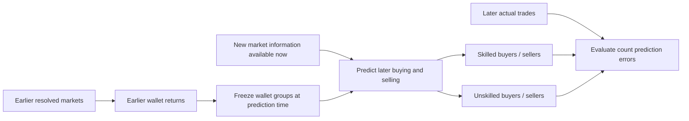

# Predict who will trade, grouped by earlier performance

**Current project target:** given a Finance market and information available at prediction time, predict how many wallets in each earlier-performance group will buy or sell during a later observation window. The earlier YES/NO-outcome model is a separate experiment, not the primary target.

## Why the observation window matters

For the same market, a model could predict 10 skilled buyers tomorrow, 30 over the next week, or 80 before trading closes. Each counts a different period. The user selected **the next seven days** for the first test. Fixed windows support comparisons across different closing dates. If a market closes during those seven days, no trades can occur after closure; keep the shorter trading exposure for audit.

The forecast begins at time `t`. Only information available by `t` enters features and wallet groups. Actual trades in `[t, t + H)` supply action/count labels. If a market closes sooner, count activity up to actual closure and retain the shorter exposure duration. Training and test windows must have ended before their labels are evaluated; a trading-participation label does not itself require the market's final YES/NO result.

## Two separate steps

| Step | Input | Output |
| --- | --- | --- |
| Define wallet groups | Resolved and reconciled performance known before `t` | Historical performance label per wallet |
| Train the participation model | Earlier group label, prior wallet activity, market properties and activity known at `t` | Probability of each wallet buying/selling, or aggregate expected counts |

The first step can be a transparent rule rather than a trained classifier. The second is the main prediction task. Neither step needs to predict the market's final YES/NO result. Profit realized versus profit predicted would instead train a separate profitability model.

## Proposed profit-based baseline

The user's suggested rule is implementable as an operational definition when complete returns are available:

1. In each earlier resolved market, compute each wallet's **net realized ROI**, using reconciled profit, costs and a specified deployed-capital denominator. Dollar profit and profit percentage are different quantities.
2. Let winners be wallets with positive ROI. Compute the mean ROI **among those winners**, not among all participants. If no winners exist, the winner mean is undefined and no above-winner-mean label is assigned for that market.
3. A winner above that mean receives an `above_winner_mean` result for that earlier market. Other observed, reconciled participants receive `not_above_winner_mean`, including losing, breakeven and below-threshold profitable wallets. Missing returns stay unknown.
4. Aggregate evidence across multiple earlier markets to define the wallet group at `t`. The first provisional implementation requires at least five comparable earlier markets and an above-winner-mean result in more than half of them for the stronger group. Exact ties count as not above; insufficient histories remain unknown. Keep event counts and uncertainty. A single market does not permanently determine the wallet's label.

This measures relative past profitability. Calling its two groups skilled/unskilled is a project convention, not statistical proof of underlying ability. For example, profitable ROIs of 2%, 4%, 6% and 88% average 25%: only the 88% wallet qualifies, even though the others profit. The average is sensitive to extreme winners; the median, or an equal-event average of each wallet's earlier market-relative ROI, are alternative baselines to compare on development data. Require multiple prior markets rather than changing a wallet's label after one result.

Importantly, `n = a + b` can describe profitable and nonprofitable participants in an earlier market, but it does not itself yield durable wallet-skill labels. If `a` means all winners, the above-winner-mean group is generally smaller than `a`; the remaining profitable wallets must have an explicit treatment. The whole prospective wallet population also needs an unknown group for incomplete/new histories.

Our current sample has historical provider PnL and settlement-edge proxies, but lacks the reconciled per-market positions, capital and costs needed for this ROI rule. Do not substitute edge or PnL/turnover and call it ROI. The existing top/bottom edge deciles remain a different baseline; they have not been relabeled to match this proposal.

## What a training example looks like

For a known candidate wallet and market at time `t`:

| Known at prediction time | Observed only later |
| --- | --- |
| Wallet group derived from earlier matured history | Whether the wallet buys within the window: 0/1 |
| Earlier trading frequency, category preferences, prior position if reconstructable | Whether it sells within the window: 0/1 |
| Market category, age, prices, volume and remaining time as known at `t` | Which outcome token it trades |

Include candidate wallets that do **not** trade, with zero action labels, provided feed coverage is adequate. Selecting candidates from the target market's eventual participant list would reveal future participation. A frozen 100-wallet candidate list gives predictions only for those 100 wallets; predicting all market participants also requires accounting for wallets outside that list and newcomers.

One possible first model predicts each known wallet's buy and sell probabilities. Summing probabilities within a frozen group gives its expected unique buyer/seller count. These expected counts can be fractional. Direct market-level count models are another option, but the present sample contains at most 100 market examples, regardless of how many wallets traded.

Wallets can both buy and sell during the same window, so the two counts can overlap. If four mutually exclusive groups are required, define net buyers, net sellers and neutral wallets separately instead of silently counting transactions. Preserve YES and NO token identity: BUY NO and SELL YES have the opposite directional meaning from BUY YES and SELL NO. Final token/direction reporting is still to be selected; stored labels should retain both side and outcome.

Evaluate buyer/seller **count MAE** on later markets; for per-wallet probabilities also evaluate action-probability calibration/log loss. Compare against historical participation rates by group/category and recent-activity baselines. Keep market/time blocks together, freeze eligibility and group thresholds before later evaluation, and report unknown-wallet coverage. The old outcome-forecast Brier result does not answer this new participation question.

## Status

The [first participation model and held-out results](../../analysis/participation/2026-01/v1/README.md) are implemented: train on 100 earlier markets from 2025 and test next-seven-day buyer/seller counts in 20 separately collected January 2026 markets. It uses a clearly marked **provider-return proxy**, rather than reconciled ROI, for the above-winner-mean rule. The training table, candidates, group labels, model parameters, predictions, actual counts and baseline comparisons are published. After-cost ROI reconstruction and validated skill labels remain unavailable. All 100 candidates are selected from earlier data; coverage outside that universe is reported rather than silently ignored.

References: [scikit-learn guidance on unavailable future information and leakage](https://scikit-learn.org/stable/common_pitfalls.html#data-leakage); [Who Calibrates Markets?](https://kalshi.com/research/kalshi-research-who-calibrates-markets.pdf), which distinguishes profitability from forecasting accuracy. Profitability-based groups are appropriate to study as their own operational definition here.
