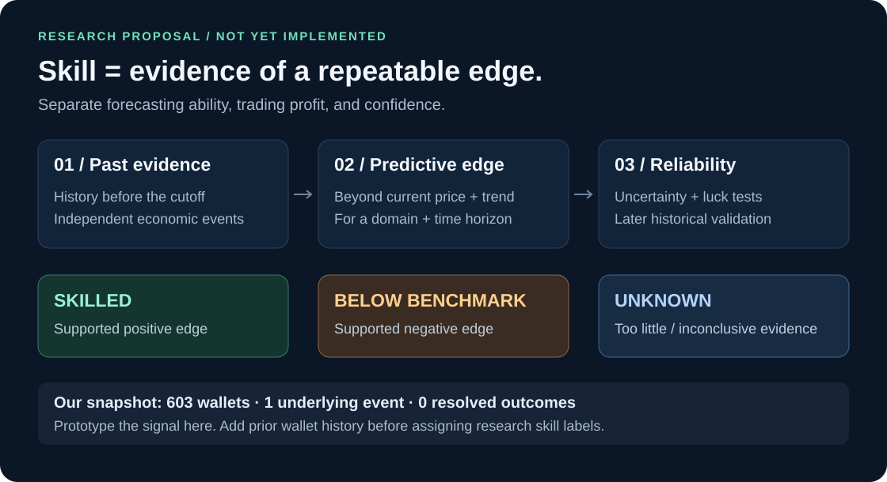

# Defining wallet skill

Research reviewed November 7, 2026. This note compares published methods with a proposed experiment for HackTheBruh. Recommendations are hypotheses to validate, not new empirical findings or implemented labels.



**Recommendation:** Keep trade count plus positive profit as a simple baseline. Define the main research score as a wallet's incremental ability to predict later prices, conditional on the market state, domain, and horizon. Keep profitability as a separate measurement. Use three evidence states rather than forcing every wallet into skilled/unskilled.

## What researchers actually do

| Approach | Operational definition | What to adopt | What to change for our project |
| --- | --- | --- | --- |
| [Jia & Sun, 2026](https://arxiv.org/html/2610.34754v1), §3.1/Table 1 | Domain-specific screens over 180/90 days: at least 20/10 resolved event clusters, win rate at least 65%/60%, positive net P&L, profit factor at least 1.2 in both windows; bidirectional-event share at most 10%; latest resolved activity within 30 days | Count independent events; require recent evidence; separate a candidate screen from a statistical skill test | Their thresholds are research choices, not universal constants. A win-rate floor ignores entry odds. Trading both sides can be legitimate hedging or liquidity provision, so use it as a strategy flag rather than automatically disqualifying the wallet |
| [Gómez-Cram, Guo, Jensen & Kung, 2026](https://papers.ssrn.com/sol3/papers.cfm?abstract_id=6617059), with [authors' explanation](https://blog.ssrn.com/2026/06/29/a-closer-look-prediction-market-accuracy-crowd-wisdom-or-informed-minority-by-roberto-gomez-cram-yunhan-guo/) | Compare actual P&L with simulated no-skill outcomes to distinguish skill from lucky profit | Test performance against an explicit luck benchmark; profitable alone is insufficient | Do not improvise independent coin flips for correlated fills. Reproduce the null construction before implementing it; a simulated P&L distribution is not necessarily an inventory-feasible trading strategy |
| [Kalshi Research, October 2026](https://kalshi.com/research/kalshi-research-who-calibrates-markets.pdf), §§3.2–3.3/Table 1 | Taker execution-price Brier skill relative to the pre-trade quantity-weighted midpoint; final eligibility at least 100 resolved events; randomized-outcome tests and Benjamini–Hochberg FDR control at 5% | Compare against the market faced at the time; account for multiple testing; separate price discovery from profit | Our snapshot has no historical pre-trade order books, so it cannot reproduce this exact score. Execution price is an assumed proxy for belief, not an observed subjective probability |
| [Bossaerts et al., 2022 preprint / 2024 journal article](https://arxiv.org/html/2209.08778v1) | Use a Kyle-model-inspired test of price-sensitive trading and informational price impact | Ask whether trading adds information; examine behavior, not just earnings | Their field-market design differs from a Polymarket order book. Price impact alone can be mechanical and does not prove useful forecasting |

An additional warning comes from [Yang's 2026 working-paper abstract](https://papers.ssrn.com/sol3/papers.cfm?abstract_id=7205590): apparent accuracy can be inflated by trades in almost-settled markets; skill measurement and performance evaluation need separate observations. This supports controlling for entry odds and time to resolution.

The exact Jia–Sun screen is a useful benchmark to reproduce, not a recommended final classifier. The Kalshi study and Polymarket studies use different venues, samples, objectives, and eligibility rules; their reported skilled-population percentages are not directly comparable. Much of the recent evidence is working-paper research.

**Access notes:** Full methods were inspected for Jia–Sun and Kalshi, and the Bossaerts preprint was available. For Gómez-Cram et al., the primary abstract and author interview were accessible; the full SSRN PDF was blocked. Yang's abstract was accessible, but its full text was not reviewed. This is a targeted review, not an exhaustive literature survey.

## Why the original baseline is insufficient

`trade_count >= 100 AND realized_profit > 0` is transparent and cheap to compute, but it conflates several things:

- **Capital:** a larger account can earn more dollars without making better decisions.
- **Luck:** one large successful position can dominate an account's record.
- **Repeated exposure:** a thousand fills on one event do not supply a thousand independent outcomes.
- **Execution:** spread capture, arbitrage, incentives, and fees affect P&L independently of forecasting.
- **Entry difficulty:** a high success rate at very expensive entry prices can still lose money.
- **Domain and horizon:** predicting football outcomes, processing earnings news, and predicting an IPO probability a week ahead are different tasks.

Hypothetical example: buy one share in each of 100 contracts at $0.99. Even 95 wins pay only $95 against $99 spent: a $4 loss before fees. Win rate alone does not measure edge.

Also, failure to reject a no-skill hypothesis is not evidence of negative skill. Our existing `classify()` function calls adequately observed wallets that fail its profit/activity rule `unskilled`; a research version should retain that result as `baseline_not_met`, separately from any statistical negative-skill label.

## Proposed definition: skill depends on the task

Store a profile indexed by `(wallet, domain, forecast_horizon, cutoff)`:

| Dimension | Question |
| --- | --- |
| Predictive edge | Does this wallet's flow improve predictions beyond current price, momentum, and other available market information? |
| Economic performance | Does its reconciled trading P&L remain positive after applicable costs, with rebates/rewards reported separately? |
| Evidence strength | How many independent event clusters support the estimate, how uncertain is it, and does it persist across past chronological splits? |

For our stated price-forecasting objective, predictive edge is the main dimension. Final-outcome forecasting would require a different evaluation using resolved outcomes and justified probability forecasts. Buying YES is not a declaration of 100% confidence, and an execution price should not silently be treated as a wallet's exact probability estimate.

### First measurable score: later price movement

Start with the taker feed, where direction has a clearer interpretation. Keep maker-related activity and profitability separate; do not label all makers unskilled.

At daily cutoff `D`, calculate the wallet's net YES-direction flow during the preceding day. BUY YES / SELL NO contribute positively; BUY NO / SELL YES negatively. Aggregate fills to one wallet–economic-event–day signal and cap concentration. This grouping is an observation unit, **not** an assumption of independent samples.

For horizon `h` of 24 hours or 7 days, an exploratory score is:

```text
direction = sign(net YES-direction flow during the day)
signed move = direction × (YES price at D+h − YES price at D)
```

Use only fully available price observations, with explicit staleness limits and `available_at` alignment. Price at `D` comes after the signal's trading window, reducing credit for the immediate move caused by those trades. Do not interpolate from later observations. The underlying prices can still be affected by execution noise and delayed market impact; this is a price-movement proxy, not proof of information or causality.

Then compare the wallet's signed moves with a reference conditioned on price level, past momentum, liquidity where observed, market age, and available time-to-resolution information. Estimate these controls on earlier training data. A raw positive signed move in a rising market is not automatically wallet-specific skill. Do not pretend the scheduled deadline is the true remaining time for a market that can resolve early.

### From an exploratory score to a defensible label

1. **Freeze the evidence date.** At cutoff `T`, use only trades, outcomes, and horizon returns observable before `T`. An observation whose 7-day return has not matured is unavailable. Exclude the target Anthropic IPO event family when scoring prior wallet skill for it.
2. **Count economic event clusters.** All brackets on the same IPO belong together, even when Gamma places them under different event IDs. Treating correlated brackets as independent exaggerates confidence.
3. **Use a candidate evidence floor.** Test 20 distinct historical event clusters and 90/180-day windows as pilot settings inspired by the screening literature. Also test 10/50/100-event floors on development data. These are experimental settings, not established sufficiency thresholds; report abstention rates.
4. **Shrink noisy estimates.** Pull low-evidence wallet estimates toward a domain baseline using a hierarchical model or regularization. Allow broader finance history to inform an IPO estimate while showing that transfer uncertainty. Do not use a perfect short record at full weight.
5. **Test uncertainty correctly.** Use event-level and time-block dependence in confidence estimation/null simulations. Control false discoveries across tested wallets and prespecified horizons. A naive bootstrap of fills or days within one event is inadequate. Ordinary BH assumptions must be checked; dependence-robust alternatives or a calibrated empirical null may be needed. A 95% posterior probability is not, by itself, a 5% cross-wallet FDR guarantee.
6. **Require persistence on later historical periods.** Choose settings on earlier windows, evaluate on later dates with a horizon-sized gap, and group correlated events together. Each live cutoff may use only validation periods already completed before it. Avoid choosing the best of many horizons after seeing results.

Only after calibration, materialize optional labels:

| Label | Proposed meaning |
| --- | --- |
| `skilled` | Positive incremental predictive edge exceeding a prespecified practical minimum, supported by uncertainty testing and later historical validation |
| `below_benchmark` | Supported negative incremental predictive edge after relevant market-state and execution controls; can map to a carefully defined `unskilled` group |
| `unknown` | Missing history, too few independent events, incomplete coverage, or an estimate not distinguishable from the benchmark |

Retain the continuous estimate and uncertainty alongside the label. Do not automatically invert a negative-score wallet's trades; whether that improves forecasts is a separate hypothesis. A continuously weighted signal is another experiment, not a guaranteed improvement over these groups.

## Implemented finance pilot

The newer [100-market wallet analysis](../../analysis/finance-wallets/2025-12-01/v1/README.md) implements point-in-time event counts, signed edge, descriptive consistency, category metrics, historical reported PnL and an explicitly exploratory sign diagnostic. Its 43 eligible wallets form four-member deciles. Complete after-cost ROI and individual probability-based Brier skill remain unavailable. The [later-outcome pilot](../../analysis/finance-backtest/2025-12/v1/README.md) finds no forecast improvement over market prices. These updates supersede the single-market next-step recommendation below; the Anthropic audit remains specific to that earlier snapshot.

## What our current dataset can support

Audit of the committed Anthropic snapshot, not a population-wide study:

| Evidence | Count / status |
| --- | ---: |
| Distinct observed wallets | 603 |
| Wallets with taker records | 474 |
| Wallets with only records outside the taker-only feed | 129 |
| Median wallet activity rows in this market | 2 |
| Wallets with at least 100 activity rows in this market | 10 |
| Wallets with at least 100 taker rows in this market | 1 |
| Independent underlying events | 1 |
| Resolved underlying events | 0 |
| Prior lifetime/category P&L | Not collected |
| Historical pre-trade order books | Not collected |

The market's 603 wallets are not 603 independent event outcomes. We can prototype daily flow/price alignment and explore signed moves here. **We cannot establish general finance skill, final-outcome accuracy, or statistically credible cross-event skill labels from this snapshot alone.** All wallets remain unclassified by a research skill standard until suitable prior evidence is added; this does not imply that none is skilled.

Keep Anthropic as the single target market. The next data task is to enrich those wallets with timestamped prior activity and results in other finance events. Collect counts, event-cluster IDs, entry prices/times, maker/taker evidence where available, realized cash flows and fees, resolution timestamps, and mature horizon returns. Do not sample wallets by current profitability or use future leaderboards.

The [Akey–Grégoire–Harvie–Martineau research dataset](https://huggingface.co/datasets/vgregoire/polymarket-users/blob/main/README.md) is a possible historical source: it includes trades, P&L panels and event mappings, with documented coverage through March 29, 2026. Wallet overlap, mapping and gaps after that date still need checking. Never import full-history terminal P&L as a historical label.

## The experiment that decides which definition to adopt

Compare four prespecified alternatives on the same evaluation windows and eligible populations:

| Variant | Purpose |
| --- | --- |
| A · trade count + positive realized profit | Original cheap baseline |
| B · published activity / profit-factor / win-rate screen | Reproducible literature baseline |
| C · incremental price-prediction edge with uncertainty | Main proposed definition for our objective |
| D · continuous shrunken wallet weights | Alternative to hard categories |

For the downstream forecast, compare current-price persistence, an otherwise identical model without wallet skill, equal-weight wallet flow, and each skill-based variant. Report held-out price MAE, usable coverage, fraction of wallets classified, concentration, and event-block uncertainty. Do not let an abstaining method appear better simply because it evaluated easier dates. Check whether results survive excluding the single most profitable event/wallet and varying reasonable development-set thresholds.

The hypothesis worth testing is: **past wallet evidence adds predictive value beyond the market's current price**. A classifier that produces convincing-looking skilled-wallet lists but fails that test should not be adopted.

## Primary references

1. Jia, H. & Sun, S. (2026), [Beyond Profit Rankings](https://arxiv.org/html/2610.34754v1), especially §3.1 and Table 1. Preprint, October 26.
2. Gómez-Cram, R., Guo, Y., Jensen, T. I. & Kung, H. (2026), [Prediction Market Accuracy: Crowd Wisdom or Informed Minority?](https://papers.ssrn.com/sol3/papers.cfm?abstract_id=6617059). Working paper; [direct author interview](https://blog.ssrn.com/2026/06/29/a-closer-look-prediction-market-accuracy-crowd-wisdom-or-informed-minority-by-roberto-gomez-cram-yunhan-guo/).
3. Kalshi Research (2026), [Who Calibrates Markets? Evidence from Trader Micro-Data](https://kalshi.com/research/kalshi-research-who-calibrates-markets.pdf), §§3.2–3.3 and Table 1. Platform research, October.
4. Bossaerts et al., [Price Formation in Field Prediction Markets: The Wisdom in the Crowd](https://arxiv.org/html/2209.08778v1), 2022 preprint; [2024 Journal of Financial Markets article](https://www.sciencedirect.com/science/article/pii/S1386418123000794).
5. Yang, H.-C. (2026), [Measuring Trader Skill in Prediction Markets: How Late Entry Inflates Forecasting Accuracy](https://papers.ssrn.com/sol3/papers.cfm?abstract_id=7205590). Working-paper abstract, July.
6. Akey, P., Grégoire, V., Harvie, N. & Martineau, C. (2026), [Polymarket Users dataset card](https://huggingface.co/datasets/vgregoire/polymarket-users/blob/main/README.md), companion data for *Who Wins and Who Loses in Prediction Markets?*
