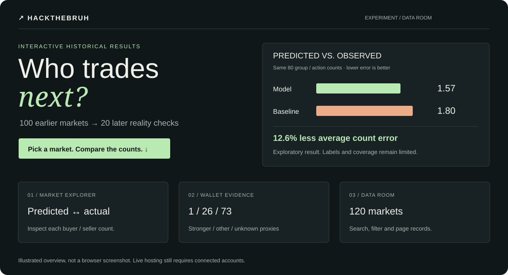

# Open the demo

[](http://127.0.0.1:4173)

**Local:** [localhost:4173](http://127.0.0.1:4173) after starting below. **Live URL:** pending Vercel connection/deployment.

| Try | See |
| --- | --- |
| Pick a 2026 market | Predicted versus observed buyers/sellers |
| Select a scatter point | Its market and exact count comparison |
| Toggle unknown wallets | Missing history stays visible |
| Search the data room | All 120 earlier/later markets |
| Open Records in Supabase mode | 50 trade records per page |

```powershell
node scripts/build-demo.mjs
node scripts/preview-demo.mjs
```

Node 20+; no npm install. The preview uses real historical results, with no full trade archive or admin credentials. Refresh it after a new experiment with `python -m polyresearch.demo`.

[Cloud setup →](../docs/deployment.md) · [Data catalog →](../docs/data-catalog.md) · [Full results →](../analysis/participation/2026-01/v1/README.md)
